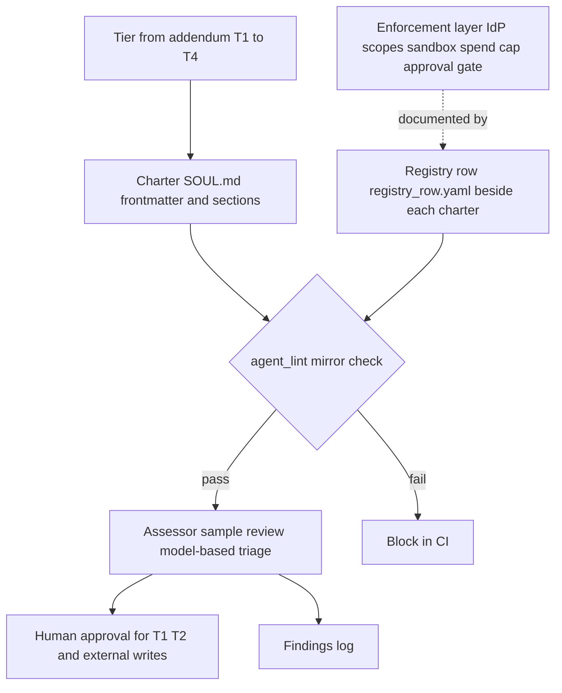

# Agentic AI Standards Pillar and Library Refresh - Plan

**Target repo:** Data_Program_Management_Resources (Markdown standards library, branch `main`). Workshop deadline: Thursday 2026-11-12.

## Goal Capsule

- **Objective:** A social-sector practitioner can take the library on 2026-11-12 and stand up a governed agent: each agent has a named owner, its own identity, a written charter that states its bounds, and a review step that checks its work, using a track sized for a small team. The reviewer is independent of the builder for T1 to T3 agents (an assessor agent, a second person, or both, by tier) and the owner for T4.
- **Means:** A new pillar `Agentic_AI_Standards/` that follows the library's pillar pattern, ships concrete templates and a linter, and reuses the AI-First Strategy Addendum's tiers and schemas instead of restating them (KTD1, KTD2).
- **Authority:** The user's request, then this plan, then the repo's existing conventions (README section 4, domain READMEs).
- **Execution profile:** Documentation-heavy. Code is limited to two Python linters with a shared helper module and tests, one CI workflow, and a one-time sweep script that is not shipped. Prose in new files obeys the owner's writing rules (R14).
- **Stop conditions:** A load-bearing external fact cannot be confirmed from a primary source (R12). Rename of folders would break a link the owner says must stay stable (A4).
- **Ships:** One pull request from a feature branch. The owner reviews and merges.

---

## Product Contract

### Summary

Add an agentic AI implementation pillar to the library and bring the existing library back to a consistent, current state. The pillar centers on per-agent identity, safety, security, a Markdown charter ("soul") for each agent, and assessor agents that review other agents' work. It covers hosted frontier models, open-weight models, and agent runtimes. A workshop kit and a lean track make it usable by small teams.

### Problem Frame

The library was written in a six-day burst in March 2026 and has not changed since. Its README omits the AI-First Strategy Addendum, the Semantic Layer Guidebook, and one Data Quality document. KPI documents sit in a differently named folder and three README locations point at a file that does not exist. The addendum covers risk tiers, boundary contracts, and AIUC-1 controls, but says nothing about agent identity lifecycle, per-agent charter files, assessor agents, open-weight models, MCP, or agent runtimes. Several external facts in it have moved: AIUC-1 now releases quarterly, EU high-risk dates shifted, and agent-specific guidance such as the OWASP Agentic Top 10 and the May 2026 Five Eyes guidance now exists.

The owner teaches an AI for Social Sector workshop on 2026-11-12. Data foundations are the prerequisite, and the missing piece is a second framework for deploying agents at scale. Social-sector teams are small, handle sensitive client data, and cannot run a full AIUC-1 program, so the framework needs a lean track beside the full one.

### Requirements

**Library refresh**

- R1. The README index lists every document on disk with correct paths, counts, and statuses, and includes a Planned section for open items.
- R2. Folder and file names are consistent: no spaces or ampersands in folder names, KPI documents sit in one correctly numbered location, and no document points at a path that does not exist.
- R3. Existing documents carry no stale tool names or pinned versions that the audit flagged and that can be fixed mechanically (Azure AD, GitHub Action majors, Python and dbt pins, renamed Databricks and dbt products). Items needing judgment or legal verification are recorded in a refresh ledger, not silently changed.
- R4. The addendum's time-sensitive facts (AIUC-1 version and controls, EU AI Act dates, NIST, OWASP, MITRE ATLAS, state laws, CI standard, BAA provider list) are re-verified against primary sources and corrected, each with a source and access date.
- R5. A repeatable lint checks index drift, backticked cross-references, header fields, and dash and vocabulary rules for new files, and runs in CI.

**Agentic pillar**

- R6. A new pillar `Agentic_AI_Standards/` follows the library template: domain README plus numbered Best Practices, Program Establishment, Standards, Auditing Guide, Config and Change Management, and KPIs documents, with an incident-response addendum and a dated landscape snapshot.
- R7. The pillar defines agent identity: one identity per agent in the organization's existing identity provider, short-lived scoped credentials, no borrowed staff credentials, a registry row per agent, delegation rules, and decommissioning.
- R8. The pillar defines the agent charter ("soul"): a Markdown file with required frontmatter and sections for purpose, owner, authority, forbidden actions, data classes, tools and scopes, approval gates, escalation, memory rules, assessor assignment, model and version pin, and review and sunset dates. A template and a worked example ship with it.
- R9. The pillar states plainly that a charter is a prompt and not an enforcement layer. Every bound in a charter names the control that enforces it outside the model, and the linter flags drift between the two.
- R10. The pillar defines assessor agents: charters, rubrics, and an operating procedure for independent review of other agents' work, with the limits of model-based judging stated and a rule that assessors are never the sole gate for high-impact actions.
- R11. The pillar covers security topics the addendum lacks: tool and MCP governance, skill and plugin supply chain, prompt injection and exfiltration, memory and context poisoning, sandboxing and egress, secrets, observability and audit trails, kill switch tests, cost caps, and incident response for agents.
- R12. The pillar covers model choice for hosted frontier and open-weight models (licensing, provenance, data residency, version pinning, deprecation) and agent runtimes (what is mature versus experimental), with every load-bearing external claim traced to a primary source in a sources ledger, and volatile facts confined to one dated snapshot document.
- R13. Social-sector specifics are first-class: consent and vulnerable populations, sensitive data classes (client, health, education, immigration, safety), equity review, funder and board reporting, insurance questions, and a lean track for teams of one to ten.
- R14. All newly authored text avoids em dashes and en dashes and the banned vocabulary list, uses prose for explanation, and uses lists and tables only for procedures, settings, and registers.
- R15. A workshop kit gives facilitators a one-page checklist, a hands-on exercise that produces a charter and a registry row for a sample agent, a worked assessor run, and facilitator notes.

### Success Criteria

- Running the lint on the finished branch reports zero errors, and CI runs it on pull requests.
- A reader can pick one sample agent, copy the charter template, fill it in, and pass the agent linter in under an hour, with no document outside the pillar needed except the addendum tiers.
- Every external date, version, or count in the pillar and the refreshed addendum resolves to a ledger entry with a primary URL and access date, or is marked unverified with the reason.

### Scope Boundaries

- Not rewriting existing documents' prose or bulk-removing the 3,100 existing dash characters. The dash rule applies to new text only.
- Not building a runnable agent platform, a hosted assessor service, or integrations with any identity provider or model vendor. Templates and linters only.
- Not converting every backticked cross-reference into a hyperlink. The lint checks that they resolve.
- Not producing slides or other binaries. Binary formats are gitignored by the owner's convention, so workshop slides stay outside the repo.

#### Deferred to Follow-Up Work

- Full judgment-dependent refresh of the ML, BI, DE, and semantic layer documents beyond the mechanical sweeps (tracked in the refresh ledger, U7).
- Regulatory notification table review in `Incident_Response_Playbook/` and `CROSS_DOMAIN_RACI.md`, which needs legal verification and an AI incident category.
- A DCAM or DMBOK edition update to the README framework line.
- Extending the AIUC-1 validator in the addendum Part 4 beyond the nine controls it implements.

**Considered and not built (3.8):** a KPI collector script (KPIs are calculated in prose and the registry fields they use); a red-team assessor template (the procedure is described in `04_Agentic_Auditing_Guide.md`, since a red-team assessor needs a runtime and is not exercised in the workshop); a vector or database-backed agent registry (a Markdown or YAML register is enough at this scale, and a store is cheap to add later); an automated LLM assessor runner (the pillar documents the procedure and ships charters, since a runner depends on each org's runtime); a cryptographic agent identity scheme such as SPIFFE or signed agent cards (the lean track says to skip these until agents talk across organizations).

### Key Decisions

- **New pillar, not an addendum rewrite.** The addendum stays the strategy document and gains cross-links and fact fixes; the pillar holds standards and templates. Governs R6, R7, R8, R10. (Owner's open area, resolved by the plan, not settled by the user.)
- **Assessors are triage and sampling, not gates.** Governs R10. Evidence: judge models show position, verbosity, and self-preference bias and are fooled by persuasive nonsense; independent reviewer agents are not shown to catch injected or collusive failures. Deterministic checks and human approval remain the gate for T1 and T2 agents.
- **Charter states bounds, enforcement lives elsewhere.** Governs R8, R9. Evidence: a persona file is injected context and can be overridden by goal hijack and memory poisoning (OWASP ASI01, ASI06).

### Dependencies and Assumptions

#### Assumptions

These are inferred, unconfirmed bets because scoping confirmation was off for this hands-off run. The owner can correct any of them on PR review.

- A1. The pillar targets Anthropic-, OpenAI-, Google-, and Microsoft-hosted models plus common open-weight families, and stays runtime-neutral. It names runtimes as examples with a maturity grade, not as endorsements.
- A2. "Agentic operating systems" is read as agent runtimes and orchestration layers (for example Claude Agent SDK, OpenAI Agents SDK, Microsoft Agent Framework, Google ADK, LangGraph, and personal-agent runtimes in the OpenClaw class), not an OS kernel.
- A3. The audience is nonprofits, foundations, and public-interest teams, many without a security staff. Lean track targets one to ten staff; full track targets T1 and T2 agents in larger organizations.
- A4. Renaming folders with spaces and the KPI folder is acceptable even though old GitHub URLs to those paths will break. The repo is private, and no external link was found in the repo itself.
- A5. The owner's vault and persona rules apply: nothing from private vaults is copied in, and no internal names or client details appear in examples.
- A6. Python 3.12 and PyYAML are acceptable for tooling, matching the Certification Framework's CI baseline (`actions/checkout@v4`, `actions/setup-python@v5`).
- A7. Primary-source verification happens at implementation time using web access. Where a primary page is unreachable, the claim is marked unverified, not dropped or asserted.

---

## Planning Contract

### Key Technical Decisions

- KTD1. **Reuse the addendum's vocabulary.** The pillar uses the addendum's tiers T1 to T4 (`AI_FIRST_STRATEGY_ADDENDUM.md` section 3.1.1), the three boundary contracts (section 3.3.1), and the agent YAML shape (section 3.2.2) as the base schema. New fields (identity, `charter_ref`, model pin, assessor) are additions, so the two documents cannot disagree. Governs R6, R7, R8.
- KTD2. **Charter is Markdown with YAML frontmatter.** Frontmatter holds machine-checked fields; body holds required H2 sections. It sits beside, and is readable by, the AGENTS.md and SKILL.md ecosystem (both now under the Linux Foundation's Agentic AI Foundation). It does not adopt the OpenClaw SOUL.md layout, because that file mixes persona with policy and its own docs advise against putting security policy in it. Governs R8.
- KTD3. **Mirror check as the enforcement bridge.** The linter compares the harm-bearing fields (write-capable tools and scopes, data classes, approval gates) between each charter and the agent's registry row (a YAML file). A mismatch is an error. Spend cap and model pin live in the registry only, and the charter references them, so teams edit them in one place. This turns "the soul states the bounds" into a testable property without claiming the charter itself enforces anything. Governs R9.
- KTD4. **Two linters, one repo.** `tools/library_lint.py` handles repo hygiene (R1, R2, R5). `tools/agent_lint.py` handles charters, registry rows, and assessor charters (R7 to R10). They share a small helper module. PyYAML and pytest are the only dependencies. Governs R5, R9.
- KTD5. **Volatile facts live in one document.** `Agentic_AI_Standards/LANDSCAPE_SNAPSHOT.md` holds dated versions, regulatory dates, model and runtime lists. Other pillar documents describe durable practice and link to it. A sources ledger `Agentic_AI_Standards/SOURCES.md` lists each load-bearing claim, primary URL, access date, and confidence. Governs R12.
- KTD6. **Two tracks.** The lean track (T3 and T4 agents, teams of one to ten) requires a charter, a registry row, a scoped service account, an approval gate on external writes and sends, and a monthly review. A T3 agent in the lean track is reviewed by a second person using the boundary assessor rubric as a checklist, or by an assessor agent; a T4 agent is reviewed by its owner. The full track adds assessor agents, adversarial testing, and AIUC-1 alignment for T1 and T2. Governs R13.
- KTD7. **Assessor design.** Assessors run on a different model family than the worker, use narrow binary rubrics, sample rather than review everything, and write findings to the registry log. Deterministic checks run first and gate; the model-based assessor adds triage. Governs R10.
- KTD8. **Guardrails on authoring.** New-file prose rules (R14) are enforced by `library_lint.py` over Markdown files under `Agentic_AI_Standards/` plus `REFRESH_LEDGER.md`, so legacy files, `tools/`, and `docs/` do not fail. The dash and banned-word patterns are built in code from escapes or a data file, so they never appear literally in scanned text. Governs R14.
- KTD9. **Mechanical sweeps by script, judgment sweeps by ledger.** Find-and-replace items from the audit (product renames, action majors, pins) are applied with a reviewed script run once, and its diff is the review surface. Anything needing a fact check or a legal call goes in `REFRESH_LEDGER.md` with owner and priority. Governs R3.

### High-Level Technical Design

Directional guidance for the agent artifact chain and the lint checks; the prose above is authoritative where they differ.



Directory layout the work creates:

```text
Agentic_AI_Standards/
  AGENTIC_README.md
  01_Agentic_Best_Practices.md
  02_Agentic_Program_Establishment.md
  03_Agentic_Standards.md
  04_Agentic_Auditing_Guide.md
  05_Agentic_Config_Change_Management.md
  06_Agentic_KPIs_and_Benchmarking.md
  AGENT_INCIDENT_RESPONSE_ADDENDUM.md
  LANDSCAPE_SNAPSHOT.md
  SOURCES.md
  templates/
    SOUL.template.md
    registry.schema.yaml
    assessors/
      charter_conformance_assessor.md
      boundary_assessor.md
  examples/
    donor_acknowledgment_agent/
      SOUL.md
      registry_row.yaml
      assessor_run.md
  workshop/
    CHECKLIST_ONE_PAGE.md
    EXERCISE_BUILD_AN_AGENT_CHARTER.md
    FACILITATOR_NOTES.md
tools/
  common.py
  library_lint.py
  agent_lint.py
  tests/
    test_library_lint.py
    test_agent_lint.py
    fixtures/
.github/workflows/lint.yml
requirements-dev.txt
REFRESH_LEDGER.md
```

### Research Basis

- Repo audit: stale-content table, index drift, header dialects, dash counts (about 3,150 dash characters in existing files, none in front matter).
- External scan, standard-mode web search, secondary sources mostly: AIUC-1 quarterly releases with a 15 Oct 2026 release adding open-weight controls; Five Eyes "Careful Adoption of Agentic AI Services" (1 May 2026); NIST CAISI AI Agent Standards Initiative and NCCoE agent identity concept paper (drafts); OWASP Top 10 for Agentic Applications (Dec 2025); EU Digital Omnibus on AI, Reg. 2026/1744 (high-risk Annex III to 2 Dec 2027, Art. 50 from 2 Aug 2026); Colorado SB 26-189 (effective 1 Jan 2027, litigation pending); MCP spec 2026-07-28; Agent Skills and A2A moved to the Agentic AI Foundation; ClawHub malicious skills and MCP STDIO command injection CVEs. All of these are inputs to U6 verification, not settled facts (A7).
- Not researched and flagged as gaps for U6: MITRE ATLAS, Inspect AI, garak, PyRIT, Langfuse, NeMo Guardrails, Llama Guard, OPA, FERPA and consent guidance for vulnerable populations, small-org cost data, Letta, Goose, OpenHands, LangGraph, CrewAI, vLLM, Ollama.

---

## Implementation Units

Unit index (nine units):

| ID | Title | Key files | Depends on |
|---|---|---|---|
| U1 | Library lint, CI, and repo hygiene files | `tools/library_lint.py`, `.github/workflows/lint.yml` | none |
| U2 | Structural normalization and README index repair | `README.md`, renamed folders | U1 |
| U3 | Agent artifact specs, templates, and agent linter | `Agentic_AI_Standards/templates/`, `tools/agent_lint.py` | U1 (shared `tools/common.py`) |
| U4 | Pillar core documents 01 to 03 | `Agentic_AI_Standards/01_*`, `02_*`, `03_*` | U3 |
| U5 | Auditing and assessor procedure (04, critical path), then change management, KPIs, incident addendum | `Agentic_AI_Standards/04_*` to `06_*` | U3, U4 |
| U6 | Landscape snapshot and sources ledger with primary verification | `LANDSCAPE_SNAPSHOT.md`, `SOURCES.md`, `tools/library_lint.py` | none for research; U1 for the SOURCES lint check |
| U7 | Addendum refresh, cross-links, mechanical sweeps, refresh ledger | `AI_FIRST_STRATEGY_ADDENDUM.md`, `REFRESH_LEDGER.md` | U2, U6 |
| U8 | Workshop kit and worked example | `Agentic_AI_Standards/workshop/`, `examples/` | U3, U5 |
| U9 | Final integration, README pillar entry, full verification | `README.md`, `AGENTIC_README.md` | U1 to U8 |

### U1. Library lint, CI, and repo hygiene files

**Goal:** A repeatable check that catches the drift the audit found, running locally and in CI.

**Requirements:** R1, R2, R5, R14.

**Dependencies:** none.

**Files:** `tools/common.py`, `tools/library_lint.py`, `tools/tests/test_library_lint.py`, `tools/tests/fixtures/`, `.github/workflows/lint.yml`, `requirements-dev.txt`, `.gitignore`, `.gitattributes`.

**Approach:**
- Checks: every root-level `*.md` and every `*.md` directly inside a domain folder is named in the README index or that domain's README; files in `templates/`, `examples/`, and `workshop/` subfolders are covered when `AGENTIC_README.md` names each one (the lint verifies this); every backticked `*.md` reference passes if it resolves relative to the repo root, relative to the file's own folder, or by a unique basename match elsewhere in the repo, and fails when the basename is missing or ambiguous (the audit found 85 legacy bare-name references that this rule accepts); folder names contain no spaces or ampersands; Markdown files under `Agentic_AI_Standards/` and `REFRESH_LEDGER.md` contain no U+2014 or U+2013 and none of the banned words (KTD8); the numbered pillar documents, `AGENTIC_README.md`, the incident addendum, and refreshed library documents carry the bold header fields (Document Owner, Version, Last Updated, Classification, Review Cycle), while templates, charters, examples, workshop files, `SOURCES.md`, and `docs/` are exempt.
- The prose-rule scope is a plain list in `tools/common.py`, extended as units add files.
- `docs/` is excluded from the README-index check.
- `tools/tests/fixtures/` is excluded from every check except the tests that target it.
- Workflow uses `actions/checkout@v4`, `actions/setup-python@v5`, Python 3.12, installs `requirements-dev.txt`, runs `pytest tools/tests` and `python tools/library_lint.py`.
- `.gitignore` carries the owner's binary rules (`.pptx`, `.key`, `.eps`, `.pdf`, `.msg`, `.doc`), `__pycache__`, and `.pytest_cache`. `.gitattributes` normalizes line endings to LF.

**Patterns to follow:** The addendum's validator style (dataclass result, class with check methods, `run_all`) in `AI_FIRST_STRATEGY_ADDENDUM.md` Part 4.

**Test scenarios:**
- A fixture tree with a file missing from the README index yields one error naming that file.
- A backticked path that does not exist anywhere yields an error with file and line; a bare filename that exists in another folder yields none; a bare filename that matches two files yields an ambiguity error.
- A folder named `KPIs & Benchmarking` yields a naming error.
- A pillar file containing an em dash, an en dash, or a banned word yields one error per hit with line number; the same text in a legacy path, under `tools/`, or under `docs/` is ignored.
- A numbered pillar document missing the `Version` header field yields an error; a template file without header fields yields none.
- `AGENTIC_README.md` omitting a file under `templates/` yields an index error naming that file.
- Clean fixture tree exits zero; any error exits nonzero.

**Verification:** `pytest tools/tests` passes. Running the lint on the unmodified repo reports the known drift (proof it detects the audit findings).

### U2. Structural normalization and README index repair

**Goal:** The library's own structure becomes consistent before a new pillar is added, so section 4 of the README is credible.

**Requirements:** R1, R2, R3 (renames only).

**Dependencies:** U1.

**Files:** `README.md`, `Data_Engineering_Standards/DE_README.md`, `Business_Intelligence_Standards/BI_README.md`, `Machine_Learning_Standards/ML_README.md`, `Data_Governance_Standards/DATAGOV_README.md`, `Data_Quality_Standards/DQ_README.md` (new), `Data_Quality_Standards/06_DQ_Complete_Suite_Builder.md`; renamed folders `Incident_Response_Playbook/`, `Vendor_Risk/`, `KPIs_and_Benchmarking/`.

**Approach:**
1. Rename the three space or ampersand folders with `git mv`; rename `05_DE_KPIs_and_Benchmarking.md` to `06_DE_KPIs_and_Benchmarking.md`.
2. Update every backticked reference to the moved paths across the repo (the audit found README lines 176, 318 to 320, DE_README lines 22, 33, 45).
3. Add README entries for the addendum, the semantic layer guidebook, and `07_DQ_dbt_Testing_Deep_Dive.md`; correct the section 3.5 heading ("root `/`"), section 9.2 counts, the "four operational domains" sentence, and the section 4 numbering note for Governance (KPI at 05) and the Data Quality series (06 to 08).
4. Add `DQ_README.md` in the domain README dialect and remove the dangling "Documents 1-5 of this series" prerequisite in `06_DQ_Complete_Suite_Builder.md` and the "docs 01-05 pending" claim in `DATAGOV_README.md`.
5. Restore a section 10.2 Planned table (initial rows: agentic pillar, regulatory notification review, judgment refresh items from the ledger).
6. Update the review date: set "Last reviewed" to 2026-11 and next review to 2027-05. Version bumps follow section 9.1.

**Test scenarios:** Test expectation: none for new code. Verification is the lint from U1 returning zero index and path errors.

**Verification:** `python tools/library_lint.py` reports no index, path, or folder-name errors. `git status` shows renames as renames, not delete and add.

### U3. Agent artifact specs, templates, and agent linter

**Goal:** Concrete, reusable artifacts for identity, charter, and assessor agents, with a linter that makes the charter bounds testable.

**Requirements:** R7, R8, R9, R10, R14.

**Dependencies:** U1.

**Files:** `Agentic_AI_Standards/AGENTIC_README.md` (skeleton, grown by later units), `README.md` (a stub pillar row so the index check passes mid-branch, completed in U9), `Agentic_AI_Standards/templates/SOUL.template.md`, `Agentic_AI_Standards/templates/registry.schema.yaml`, `Agentic_AI_Standards/templates/assessors/charter_conformance_assessor.md`, `Agentic_AI_Standards/templates/assessors/boundary_assessor.md`, `tools/agent_lint.py`, `tools/tests/test_agent_lint.py`, `tools/tests/fixtures/agents/`.

**Approach:**
- Charter frontmatter fields: `agent_id`, `tier` (T1 to T4), `owner`, `backup_owner`, `purpose`, `model` (provider, id, pinned version), `runtime`, `identity` (account name, credential type, max token lifetime), `data_classes`, `tools` (name, scope, read or write), `approval_gates`, `spend_cap_usd_month`, `assessor`, `review_date`, `sunset_date`, `enforcement_refs`.
- Required body sections as H2: Purpose, Authority, Forbidden Actions, Data Handling, Tools and Scopes, Approval and Escalation, Memory Rules, Voice, Failure Behavior, Assessor and Review, Decommissioning.
- `registry.schema.yaml` defines one row per agent with the mirrored harm-bearing fields plus `spend_cap_usd_month`, `model` (provider, id, pinned version, `family`), `enforcement` (where each bound is enforced: IdP scope name, sandbox profile, proxy rule, budget alert), `status`, and `last_assessed`.
- **Discovery contract.** The linter scans a path for files named `SOUL.md` or `*.charter.md`; every other Markdown file is ignored. A charter's row is `registry_row.yaml` in the same folder, or an entry keyed by `agent_id` in an optional `registry.yaml` in that folder for multi-agent folders. The registry is therefore a set of per-agent rows, and the High-Level Technical Design label means that set.
- Linter checks: required frontmatter and sections present; tier valid and consistent with addendum rules (T1 and T2 require an assessor agent and at least one approval gate; T3 requires an assessor agent or a named second-person reviewer; T4 may omit both); harm-bearing fields match the registry row (KTD3); `review_date` not in the past; `sunset_date` present; no secrets patterns (key-like strings) in the charter; an assessor's `family` differs from its target's `family` (KTD7); write tools without an approval gate on T1 to T3 are errors.
- Assessor charters use the same format with extra required sections: Rubric (binary questions), Sampling Rule, Evidence Format, and Limits.

**Technical design (directional):**

```text
for charter in charters:
    fm, body = parse(charter)
    row = registry[fm.agent_id]
    errors += required_fields(fm) + required_sections(body)
    errors += mirror(fm.write_tools, row.write_tools) + mirror(fm.data_classes, row.data_classes)
    errors += mirror(fm.approval_gates, row.approval_gates)
    errors += tier_rules(fm.tier, fm.assessor, fm.approval_gates, fm.tools)
    errors += family_differs(row.model.family, assessor_row_of(fm).model.family)
```

**Patterns to follow:** The agent YAML in `AI_FIRST_STRATEGY_ADDENDUM.md` section 3.2.2 and the three boundary contracts in section 3.3.1; `ControlResult` dataclass shape from Part 4.

**Test scenarios:**
- A complete charter and matching registry row passes with zero errors.
- A charter missing the Forbidden Actions section yields one error naming the section.
- A charter listing a write tool that the registry row lacks yields a mirror error naming the tool.
- A T2 charter with no assessor yields an error; a T4 charter with none passes.
- A charter whose `review_date` is before today yields an error.
- A charter containing a string matching an API key pattern yields an error that does not echo the full string.
- An assessor on the same model family as its target yields an error.
- A write tool without an approval gate on a T3 charter yields an error.
- Template files themselves lint clean when placeholders are filled by the test fixture.

**Verification:** `pytest tools/tests/test_agent_lint.py` passes; `python tools/agent_lint.py Agentic_AI_Standards/examples` exits zero once U8 lands.

### U4. Pillar core documents 01 to 03

**Goal:** The principles, operating model, and binding standards for implementing agents, in the library's document dialect.

**Requirements:** R6, R7, R8, R9, R11, R12, R13, R14.

**Dependencies:** U3.

**Files:** `Agentic_AI_Standards/01_Agentic_Best_Practices.md`, `Agentic_AI_Standards/02_Agentic_Program_Establishment.md`, `Agentic_AI_Standards/03_Agentic_Standards.md`.

**Approach:**
- Use header dialect B (bold header lines plus table of contents and separators) with `Classification: Internal, Binding Standard` style text that avoids dashes.
- 01 Best Practices (prose-led): the autonomy ladder tied to addendum stages; why a charter is a prompt and what must be enforced outside it (R9); identity and least privilege; human oversight that avoids approval fatigue (few, high-impact gates); memory and context hygiene; prompt injection and exfiltration; model choice for frontier versus open-weight (provenance, licence, residency, pinning); runtime selection criteria; anti-patterns including borrowed staff credentials, public skill registries on client-data agents, and persona files that carry policy.
- 02 Program Establishment: roles reusing the addendum's CAIO and AI Risk Lead, plus an Agent Owner role; lean versus full track (KTD6); phased build; agent inventory and shadow-agent discovery; funder, board, and insurer conversations; budget ranges expressed as inputs the owner fills in, not invented prices.
- 01 also carries an equity review step: before an agent touches decisions about people, name who could be harmed or excluded, test outputs across the groups the organization serves, and record the result in the charter. 03 carries a consent and vulnerable-populations standard: what consent covers when an agent processes client data, which populations (children, immigrants, survivors of violence, patients) require extra approval or exclusion from agent use, and who may override.
- 03 Standards (binding, MUST and SHOULD language): identity standard; charter standard (cites `templates/SOUL.template.md`); registry standard; tool and MCP standard (allowlist, pinned versions, authorization per the current MCP spec, no STDIO servers from untrusted sources); skill and plugin intake standard; memory standard (provenance, review, expiry); secrets standard; sandbox and egress standard; observability and audit log standard; kill switch standard with a test cadence; spend cap standard; data class handling for client, health, education, immigration, and safety-sensitive data.
- Every standard that a charter can state names its enforcement layer (R9). Time-sensitive claims link to `LANDSCAPE_SNAPSHOT.md` rather than stating dates.
- Link, do not restate, the addendum's tiers, boundary contracts, and multi-agent principles (KTD1).

**Test scenarios:** Test expectation: none for code. The lint (U1) checks headers, dashes, banned words, and references.

**Verification:** Lint reports zero errors on the three files. A read-through confirms each R7 to R9, R11, R13 item has a named section.

### U5. Auditing guide with assessor agents, change management, KPIs, incident addendum

**Goal:** The review, change, measurement, and incident procedures that make the standards operable.

**Requirements:** R10, R11, R12, R13, R14.

**Dependencies:** U3, U4.

**Files:** `Agentic_AI_Standards/04_Agentic_Auditing_Guide.md`, `Agentic_AI_Standards/05_Agentic_Config_Change_Management.md`, `Agentic_AI_Standards/06_Agentic_KPIs_and_Benchmarking.md`, `Agentic_AI_Standards/AGENT_INCIDENT_RESPONSE_ADDENDUM.md`.

**Approach:**
- 04: three lines of defense applied to agents (builder self-check, independent assessor agents and human reviewer, internal or third-party audit); operating procedure for assessors (KTD7): deterministic checks first, sampling rule, binary rubric, different model family, evidence format, escalation to a human; documented limits of model-based judging (position, verbosity, self-preference bias, vulnerability to persuasive nonsense) and calibration against human labels; assessor charters reference `templates/assessors/`; red-team procedure aligned to OWASP Agentic Top 10 categories and cross-referenced to addendum section 3.4.2; kill switch drill procedure.
- 05: config-first pattern for charters and registry in version control; change tiers matching README section 8.1; model version pinning and re-evaluation before a model change; deprecation watch (model retirements arrive on published schedules, so the standard requires an owner-checked calendar); skill and MCP server allow-list change process; rollback.
- 04 also carries the equity review step as an audit check and describes the red-team assessor type in prose (KTD7, considered-and-not-built list).
- 06: KPI registry in the library's format (for example share of agents with current charter, assessor coverage, approval-gate override rate, incident count, mean time to disable, spend versus cap), each with its calculation described against registry fields. No collector code.
- Incident addendum: agent-specific severity ladder, first-hour actions (disable, revoke credentials, freeze memory, preserve logs), memory purge and rebuild, notification triggers that point to the existing playbook instead of restating statutory clocks, and a post-incident charter update step. A required step before relying on any notification clock: confirm it with counsel, with a note that the playbook's table has not been reviewed since March 2026.
- Order of work: write 04 first, since U8 depends on it; 05, 06, and the incident addendum follow.

**Test scenarios:** Test expectation: none, documentation only.

**Verification:** Lint zero errors; each assessor procedure step in 04 maps to a field in the assessor template.

### U6. Landscape snapshot and sources ledger with primary verification

**Goal:** Volatile facts are confirmed against primary sources, dated, and confined to one document.

**Requirements:** R4 (inputs), R12.

**Dependencies:** none for the research; U1 for the SOURCES lint check. Can run in parallel with U3 to U5.

**Files:** `Agentic_AI_Standards/LANDSCAPE_SNAPSHOT.md`, `Agentic_AI_Standards/SOURCES.md`, `tools/library_lint.py`, `tools/tests/test_library_lint.py` (the SOURCES check only).

**Approach:**
0. Breadth cap: verify the runtimes named in A2 and one tool per category (eval, red team, observability, guardrail), plus every standard and regulation in the research basis. Name any other runtime or tool in the snapshot as "not covered in this edition" and list it under Planned in README section 10.2.
1. Re-fetch primary pages for every row in the research basis marked as needing verification: AIUC-1 changelog and latest release, CISA Five Eyes guidance, NIST AI RMF and CAISI pages, OWASP Agentic Top 10, EU Official Journal text of Reg. 2026/1744 or a Commission page, Colorado SB 26-189 status, the MCP specification revision, Agent Skills and A2A foundation announcements, and vendor deprecation pages for the models named.
2. Research the recorded gaps with web access: MITRE ATLAS current techniques, eval and red-team tools (Inspect AI, garak, PyRIT, promptfoo), observability (OpenTelemetry GenAI conventions, Langfuse), guardrail options, open-weight licence files for each family named, runtime maturity (LangGraph, Letta, Goose, OpenHands, Microsoft Agent Framework, Google ADK, Claude Agent SDK, OpenAI Agents SDK), and social-sector sources (Candid, NTEN, Fast Forward, Project Evident, FERPA and consent guidance).
3. Snapshot document: dated sections for standards and regulation, identity and protocol status, runtimes (maturity grade: teach, trial, watch, avoid), model families with licence type and residency note, known incidents, and a "check before relying" banner with the access date.
4. Sources ledger: one row per claim with primary URL, access date, confidence (confirmed, secondary only, unverified), and which document cites it.
5. Resolve date conflicts the scan found (A2A v1.0, Entra Agent ID GA, Five Eyes publication day, Anthropic RSP version) and record the winning source.

**Test scenarios:** Test expectation: none for code. `library_lint.py` gains one check in this unit: every `SOURCES.md` row has a URL and an access date (added to U1's test file).

**Verification:** No row in the snapshot lacks a ledger entry. Any row left unverified is labeled so in both files and listed in the PR body.

### U7. Addendum refresh, cross-links, mechanical sweeps, refresh ledger

**Goal:** Existing documents stop contradicting the new pillar or current facts, and everything not fixed is recorded.

**Requirements:** R3, R4.

**Dependencies:** U2, U6.

**Files:** `AI_FIRST_STRATEGY_ADDENDUM.md`, `Machine_Learning_Standards/02_ML_Program_Establishment.md`, `Business_Intelligence_Standards/02_BI_Program_Establishment.md`, `Vendor_Risk/VENDOR_THIRD_PARTY_DATA_RISK_STANDARD.md`, `Incident_Response_Playbook/DATA_INCIDENT_RESPONSE_PLAYBOOK.md`, `CROSS_DOMAIN_RACI.md`, `REFRESH_LEDGER.md`, plus files touched by the mechanical sweep.

**Approach:**
- Addendum: correct AIUC-1 version, release cadence, and control references using U6 findings; add EU AI Act dates with a pointer to the snapshot; add Five Eyes, OWASP Agentic Top 10, and NIST agent work to the framework list; state one CI standard (GitHub Actions, as the README stack lists) and mark the Azure DevOps pipeline as an alternative; add AWS-neutral language for processing locations; update the BAA provider list with a pointer to verify per contract; fix "Library v2.0" and the review date; add a version-history row.
- Cross-links: addendum to pillar and pillar to addendum; ML 02 lines for the LLM governance framework; BI 02 Copilot item; Vendor standard gains a pointer for AI model-provider and open-weight due diligence; Incident playbook and RACI each gain a pointer row for agent incidents and agent roles (full RACI rework deferred).
- Mechanical sweep, scripted once and diff-reviewed (KTD9): Azure AD to Entra ID, `actions/checkout` and `setup-python` majors to the Certification Framework baseline (`@v4` and `@v5`), Python 3.11 to 3.12, with `aws-actions/configure-aws-credentials` (only `@v2` in `Data_Engineering_Standards/05_DE_Config_Change_Management.md`) sent to the ledger because the baseline carries no value for it, renamed Databricks and dbt product names, MLflow stage calls to alias wording, Tableau Ask Data wording. Each rename is checked against the product's current naming before applying; any doubt goes to the ledger.
- `REFRESH_LEDGER.md`: the remaining audit rows (about 50 candidates) with owner, priority, and what to verify, so nothing found is lost.

**Test scenarios:** Test expectation: none for new code. The sweep script, if kept in the repo, is not shipped; only its diff is.

**Verification:** Lint zero errors. Grep for the sweep's old strings returns only deliberate historical mentions. Every addendum fact changed in this unit has a ledger entry in `SOURCES.md`.

### U8. Workshop kit and worked example

**Goal:** A facilitator can run the pillar in a workshop room with a small-team audience.

**Requirements:** R13, R14, R15.

**Dependencies:** U3, U5.

**Files:** `Agentic_AI_Standards/workshop/CHECKLIST_ONE_PAGE.md`, `Agentic_AI_Standards/workshop/EXERCISE_BUILD_AN_AGENT_CHARTER.md`, `Agentic_AI_Standards/workshop/FACILITATOR_NOTES.md`, `Agentic_AI_Standards/examples/donor_acknowledgment_agent/SOUL.md`, `Agentic_AI_Standards/examples/donor_acknowledgment_agent/registry_row.yaml`, `Agentic_AI_Standards/examples/donor_acknowledgment_agent/assessor_run.md`.

**Approach:**
- Worked example: a T3 agent that drafts donor thank-you messages from a CRM export, writes only drafts, and never sends. It has a scoped service account, an approval gate on any send, a spend cap, and a named owner role (no real names). The assessor run shows a binary rubric applied to five sample outputs, one failing, with the escalation record.
- Exercise: participants pick an agent idea, fill the charter template, fill a registry row, run `agent_lint.py`, and swap with a neighbor to play assessor using the boundary assessor rubric. Includes a lean-track path with no tooling beyond a text editor and a manual checklist version of the linter's checks.
- One-page checklist: the ten questions to answer before an agent touches client data (including one on consent for vulnerable populations and one on equity review), plus the "ten things you may not have considered" list from the research, each as one line linking to its standard.
- Facilitator notes: timing for a 90-minute and a half-day format, common failure modes, and a short list of "check before relying" facts to confirm on the morning of the workshop, pointing to `LANDSCAPE_SNAPSHOT.md`.

**Test scenarios:**
- The example charter and registry row pass `agent_lint.py` with zero errors.
- A deliberately broken copy (charter lists a send tool the registry lacks) is included under `tools/tests/fixtures/agents/` and fails with the expected mirror error.

**Verification:** `python tools/agent_lint.py Agentic_AI_Standards/examples` exits zero. A person who has not seen the pillar can complete the exercise from the exercise file alone (reviewed by reading it cold).

### U9. Final integration and full verification

**Goal:** The pillar is indexed, consistent, and the whole branch passes its own checks.

**Requirements:** R1, R5, R6, R14.

**Dependencies:** U1 to U8.

**Files:** `README.md`, `Agentic_AI_Standards/AGENTIC_README.md`, `tools/common.py` (allowlist final), `REFRESH_LEDGER.md`.

**Approach:**
- Write `AGENTIC_README.md` in the domain README dialect (document index, quick navigation, key conventions, audit cadence, cross-domain dependencies, links to the addendum and the snapshot).
- Add the pillar to README sections 1 (stack note), 3 (new 3.7), 5 (RACI pointer), 6.2, 7.2, 8.2, 9.2, 10.1, and 11, and update the "How to use this library" persona table with a practitioner row for agent builders.
- Finalize the lint allowlist so every new file is covered; run the whole suite.
- Run a cold read of the pillar for contradictions between charter spec (U3), standards (U4), and examples (U8).

**Test scenarios:** Test expectation: none beyond the existing suites; this unit exercises them.

**Verification:** See Verification Contract.

---

## Verification Contract

| Gate | Command or check | Applies to |
|---|---|---|
| Unit tests | `pytest tools/tests` | U1, U3, U6, U8 |
| Library lint | `python tools/library_lint.py` exits zero | U2, U4 to U9 |
| Agent lint | `python tools/agent_lint.py Agentic_AI_Standards/examples` exits zero; `python tools/agent_lint.py tools/tests/fixtures/agents/broken` exits nonzero with the expected error | U3, U8 |
| Prose rules | Lint dash and vocabulary check over the allowlist returns zero hits | U4 to U9 |
| Source traceability | Every `LANDSCAPE_SNAPSHOT.md` row appears in `SOURCES.md`; unverified rows are labeled | U6, U7 |
| CI | The `lint.yml` workflow passes on the pull request | U1, U9 |
| Cold read | One read-through of pillar plus exercise by someone not involved in drafting, or a fresh agent session, reports no contradiction between charter spec, standards, and example | U9 |

Python 3.12 or newer and PyYAML and pytest from `requirements-dev.txt` are required locally; the Windows host in this session runs Python 3.14 with both installed.

## Definition of Done

- All nine units delivered, with lint, agent lint, and unit tests passing locally and in CI.
- README indexes every document; no path points at a missing file; no folder name contains a space or ampersand.
- Every new-pillar file passes the prose rules; every volatile fact in the pillar and the refreshed addendum has a ledger entry or an "unverified" label.
- `REFRESH_LEDGER.md` lists every audit item not fixed, with owner and priority.
- The PR description lists assumptions A1 to A7, anything marked unverified, the folder renames and what they break, and the deferred items.
- Abandoned drafts, scratch scripts (including the one-time sweep script), and unused fixtures are removed from the diff.

## Risks and Mitigations

| Risk | Effect | Mitigation |
|---|---|---|
| Landscape facts are secondary-sourced and several conflict | A wrong date or version taught at the workshop | U6 verifies from primary pages; unverified items labeled; facilitator notes list morning-of checks (KTD5) |
| Charter is mistaken for a control | Teams rely on Markdown for safety | R9, the mirror check, and a bold statement in 01, 03, and the template header (KTD3) |
| Assessor agents give false assurance | A bad output passes review | Assessor is never the sole gate for T1 and T2; deterministic checks first; calibration step in 04 (KTD7) |
| Folder renames break old URLs | Bookmarks and shared links fail | Called out in PR body; no in-repo links affected (A4) |
| Scope exceeds the time to 2026-11-12 | Pillar incomplete at workshop | U1, U3, U4, U5 (document 04 only), U6, U8 form the workshop-critical path; U2, U5 (05, 06, incident addendum), and U7 can trail without blocking the workshop |
| Mechanical sweep changes meaning | A rename is wrong for a context | Diff review per KTD9; doubtful items go to the ledger |
| Open-weight licences drift | Guidance goes stale quickly | Licence column lives only in the snapshot, with access dates |

## Open Questions

### Deferred to implementation

- Exact set of banned-word and dash exceptions needed for quoted material (quotes of external standards inside new files); the lint should allow a marked quotation block.
- Final runtime maturity grades (teach, trial, watch, avoid), which depend on U6 findings.

### For the owner

- Whether to bulk-clean the existing 3,100 dash characters (about 1,540 are empty RACI table cells). The plan leaves them untouched.
- Whether the repo should stay private after the workshop, since the pillar is workshop-facing and may be shared.

## Sources

- Repo audit and landscape scan dossiers from this planning run (not committed). Their load-bearing claims are re-verified in U6 and tracked in `Agentic_AI_Standards/SOURCES.md`.
- `AI_FIRST_STRATEGY_ADDENDUM.md` sections 3.1.1, 3.2.2, 3.3.1, 3.4.2, and Part 4 for tiers, schema, boundary contracts, adversarial testing, and validator style.
- `README.md` section 4 (template), section 9 (version control), and domain README dialect in `Business_Intelligence_Standards/BI_README.md`.
